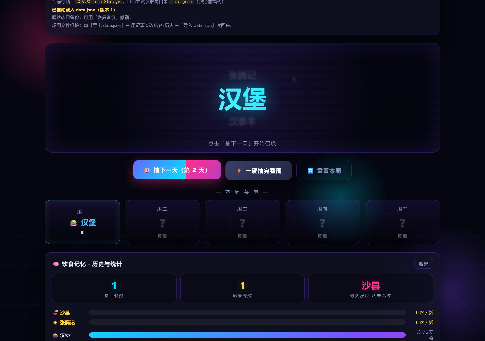

# 今天吃什么 · 抽卡召唤阵

> 单文件、零依赖、双击就能用的「一周吃什么」抽卡小工具。
> 把食堂店名丢进去，它用二次元召唤动画替你决定每天吃什么，并且**尽量不重复**。

**特性一览**

- 🗂 **单文件自包含** —— 主程序 HTML / CSS / JS 全内联在 `index.html` 里，无构建步骤、无 npm、无 CDN、无外网请求
- 🖱 **双击即用** —— 下载后用浏览器直接打开就能抽，不需要服务器、不需要联网
- 🎰 **八套抽卡演出** —— 魔法阵召唤 / CSGO 开箱 / 赛博老虎机 / 命运卡牌 / **塔罗牌（手动选牌）** / 地狱烈焰 / 星象召唤 / 宝石爆裂，随机轮换
- 🔮 **真塔罗牌牌库** —— 78 张标准牌（Rider–Waite），专属 SVG 牌面 + 正逆位牌意，配手动翻牌
- 🏅 **R / SR / SSR / UR 四档稀有度** —— 不同等级的粒子量、音效、卡片边框流光都不一样
- 🧠 **饮食记忆** —— 跨周自动归档历史、统计每家吃了多少次、「距上次吃 X 天」提示
- ⚖️ **加权发牌** —— 越久没吃的店权重越高，避免天天抽到同一家
- 📂 **data.json 双向导入导出** —— 用记事本就能改店名和历史
- 🔒 **纯本地** —— 所有数据只落在你自己的浏览器 localStorage 和本地文件里

---

## 📸 截图

**主界面**


**抽签后**



**塔罗牌：手动选牌**


**塔罗牌：翻牌后的牌面与解读**


---

## 🚀 快速开始

### 方式 A：双击打开（最省事）

1. 下载或克隆本仓库。
2. 直接**双击 `index.html`**，用浏览器打开。
3. 在「⚙ 食堂配置」里填店名，开始抽。

不需要安装任何东西，不需要起服务器，不需要联网。

> ⚠️ 这种 `file://` 模式下，浏览器会用 CORS 策略拦掉 `fetch`，所以**同目录的 `data.json` 不会被自动读取**。
> 数据保存在当前浏览器的 `localStorage`（键名 `lunch_gacha_v1`）里；换浏览器或清缓存会丢。
> 想用文件维护数据，请走下面的方式 B，或者直接用页面上的「💾 导出」/「📂 导入」按钮。

### 方式 B：本地服务器（推荐给要改数据的人）

```bash
# 在项目根目录执行（任选其一）
python -m http.server 8000
# 或
npx serve .
```

然后浏览器打开 `http://localhost:8000/`。

**两种模式的差别**

| | 方式 A · 双击打开 | 方式 B · 本地服务器 |
|---|---|---|
| 协议 | `file://` | `http://localhost:8000` |
| 数据主存储 | 浏览器 `localStorage` | 浏览器 `localStorage` |
| 自动读取同目录 `data.json` | ❌ 被 CORS 拦截 | ✅ 启动时自动载入 |
| 手动导入 / 导出 data.json | ✅ 可用 | ✅ 可用 |
| 需要装东西 | 不需要 | 需要 Python 或 Node |

---

## 🎮 功能详解

### 抽卡演出（多套，随机轮换）

**⭕ 魔法阵召唤**

1. 三层旋转圆环 + 符文圈亮起，14 颗光球从四周向中心汇聚，屏幕轻微震动；
2. 白闪 + Canvas 彩带粒子爆开；
3. 老虎机式名字轮盘减速滚动（`requestAnimationFrame` 驱动，间隔由 32ms 逐渐拉长到 650ms），每跳一格响一声咔哒；
4. 3D 翻卡揭示结果，等级越高停留越久（UR 2.6s / SSR 2.2s / 其余 1.8s）。

**📦 CSGO 开箱**

1. 46 张卡横排滚动（`Element.animate`，5 秒，带模糊到清晰的景深过渡）；
2. 卡面颜色按 CS 风格分级（消费级 / 工业级 / 军规级 / 受限 / 保密 / 隐秘 / 罕见）；
3. 中奖卡左右各埋一张高等级的「差一点就中」诱饵卡，滚动过程中咔哒声随减速变稀；
4. 定格在中奖卡上 → 放大发光 + 白闪 + 粒子爆开。

**🎰 赛博老虎机**

1. 三列同时滚动，名字飞速翻动；
2. 三列**错开停止**（依次停稳，每停一列响一声咔哒，列框发光 + 白闪）；
3. 最后一列停在结果上 → 粒子从该列位置爆开，UR 时边框金色流光。

**🎴 命运卡牌**

1. 一叠牌背朝上摊开；
2. 逐张翻牌亮出（3D `rotateY` 翻转 + 音效 + 轻微粒子），节奏由慢到快；
3. 最后一张是结果牌 → 牌面放大发光 + 白闪 + 冲击波环。

**🔥 地狱烈焰**

底部火焰粒子**向上喷发**，橙色/红色渐变聚成结果文字，最后一次白光爆燃。

**🌌 星象召唤**

Canvas 画一片随机星点与近邻连线，整体缓慢旋转；某个星点突然高亮放大并与全网连成星芒，化为结果。

**💎 宝石爆裂**

六块 `clip-path` 多边形碎片拼成一颗翡翠色晶体 → 从中心裂开、碎片飞散 → 露出结果。

**🔮 塔罗牌（手动选牌）**

这是唯一一套**要你自己动手**的演出：

1. 舞台上摊开 **3 张背面朝上的塔罗牌**（扇形排开、呼吸悬浮、星光粒子环绕）；
2. **你点选其中一张**（鼠标悬停会抬起高亮），程序不会替你选；
3. 牌 **3D 翻转**，露出**真实牌面**——完整 78 张标准塔罗牌（22 张大阿卡纳 + 56 张小阿卡纳），
   大阿卡纳是专属矢量图案，小阿卡纳是花色符号 + 数字牌阵；
4. 牌面下半部分显示**今天抽到的食物和稀有度**；
5. 展开这张牌的**正位 / 逆位牌意**（Rider–Waite 标准释义），再给一句把牌意和食物串起来的解读。

> 想省时间？20 秒不动会自动替你选一张，流程不会卡住。

**牌库说明**

- **78 张齐全**：22 张大阿卡纳（愚者 0 → 世界 XXI）+ 56 张小阿卡纳（权杖 / 圣杯 / 宝剑 / 星币 各 14 张）。
- **牌面是真矢量图**：每张大阿卡纳都是专门画的 SVG 线描图案（愚者的太阳与悬崖、
  魔术师的 ∞ 与权杖、女祭司的新月双柱、恶魔的倒五芒星与锁链、高塔的塔身闪电……），
  不是 emoji 凑数。小阿卡纳用花色符号（权杖 / 圣杯 / 宝剑 / 星币）配数字排布。
- **牌意是真牌义**：按 Rider–Waite–Smith 通行体系，大牌正逆位按经典对照，
  小牌按「花色元素（火/水/风/土）+ 数字 + 宫廷位」给出；逆位是逆位的通行含义，不是正位反着写。
- 牌库在 `tarot-data.js` 里，单独成文件是为了让这 156 条牌义可维护、可校对。

**随机轮换怎么算的**：每次抽签会记录各套动画的「出场序号」，下一次按「距上次出场隔了多少次抽签」加权，**越久没出场的越容易被选中**（权重 = 1 + 间隔次数，每套都有保底权重，保证八套都轮得到、不会一家独大）；页面上的「出场间隔」一行会实时显示各套动画各自的上次出场信息，也可以手动锁定其中一套。

### 演出强度

配置区有独立的「演出强度」选择器，三档：

| 档位 | 行为 |
|---|---|
| 🎬 **全开** | 完整时长演出（默认） |
| ⚡ **快速** | 时长压缩到约 1/3（召唤、轮盘、开箱滚动都缩短），但**动画步骤一个不少**——光球照样汇聚、轮盘照样转、卡带照样滚 |
| ⏭️ **关闭** | 跳过演出，点击直接出结果 |

> **本程序不理会系统的「减少动效」设置。**
> 演出是这个页面的核心内容，不该被系统偏好悄悄拿走——即使你的系统关了动画，
> 这里的抽卡演出照播、背景特效也照动。想要更安静就用上面的「⏭️ 关闭」手动关。

### 稀有度

| 等级 | 概率 | 结算粒子数 | 音效 | 视觉 |
|---|---|---|---|---|
| **R** | 52% | 60 | 两声正弦上行音 | 蓝色边框，冷色光晕 |
| **SR** | 30% | 95 | 三音和弦（sine） | 紫色边框 |
| **SSR** | 15% | 150 | 四音琶音 + 噪声 | 金色边框 + 文字辉光 |
| **UR** | 3% | 220 | 六音上行 + 长噪声 | 渐变流光描边，菜单卡持续变色 |

概率在 `rollRarity()` 里按权重区间抽样。音效**全部由 Web Audio API 实时合成**（振荡器 + 噪声缓冲 + 滤波 + 增益包络），仓库里没有任何音频文件。

### 大周 / 小周与「加餐日」

- **大周**排 5 天（周一至周五），**小周**排 6 天（周一至周六）。
- 店名数量 **≥ 天数** 时，一周之内**全程不重复**。
- 店名数量不够时才会出现重复，**同一家店在一周内第二次出现的那一天，会被标上「加餐日」标签**，揭示卡、菜单卡片、复制出来的文本三处口径一致。
- 未抽的日子会提示「待抽」；如果按当前候选池算下来那一段注定要重复，会提前提示「会重复」
  （标的位置就是真正会重复的那几格——候选池每抽走一家就少一家，所以前 N 天必然各不相同，从第 N+1 天起必然重复）。
- 「🔄 重置本周」会清掉本周菜单和本周那条历史记录，其他周不受影响。

### 饮食记忆（历史与统计）

- **跨周自动归档**：`weekStart` 记的是当周周一，过了周一再打开，上周的菜单自动进历史，本周重新开始。同一周反复抽签只会覆盖那一条，不会堆重复记录。历史最多保留 60 周。
- **KPI 卡**：累计餐数、记录周数、最久没吃的一家（没吃过显示「从未吃过」）。
- **排行条**：每家店的累计次数 + 「N 天前」；超过 7 天没吃的会高亮成金色。
- **历史列表**：显示最近 20 周的日期区间、周类型和菜单。
- **「📄 导出全部历史」**导出成纯文本，可以直接贴到群里。

### 加权发牌

抽签不是纯随机。每家店按「距上次吃的天数」算权重：**权重 = 1 + 距上次天数**（封顶 61 天，
即 1~61），从没吃过的按 61 天计——所以越久没吃越优先，但不会变成「只要有一家没吃过就必选它」，
各家之间仍有梯度。抽中的店会从本周候选池里移除，所以同一周内不会重复抽到同一家。

> 同样的口径也用来判断「距上次吃 X 天」的提示，以及统计面板里的高亮（超过 7 天没吃的会标金色）。

### 复制菜单

本周排满后会出现「📋 复制本周菜单」，生成形如：

```
本周菜单（大周5天）
周一：沙县  [R]
周二：汉堡  [SR]
周三：张腾记  [SSR]
```

重复的那天会带「（加餐日）」后缀。

---

## 📄 data.json 数据格式

`data.json` 是这个项目的「可编辑存档」。用记事本就能改店名、改历史，改完用页面的「📂 导入 data.json」读回来，或者在服务器模式下放回项目根目录自动生效。

一个完整可用的例子：

```json
{
  "_comment": "今天吃什么 · 数据文件。改完 options（店名）/ history（历史）后，用页面上的「📂 导入 data.json」读回来即可生效。用 http 服务器打开本页时会自动加载这个文件。",
  "version": 1,
  "updatedAt": 1790000000000,
  "options": ["沙县", "张腾记", "汉堡", "汉泰丰", "麻辣烫"],
  "weekType": "big",
  "animPref": "random",
  "animLog": {
    "gacha": { "seq": 7, "date": "2026-10-27" },
    "csgo": { "seq": 8, "date": "2026-10-28" }
  },
  "drawSeq": 8,
  "weekStart": "2026-10-26",
  "results": [
    { "name": "沙县", "rarity": "R", "date": "2026-10-26" },
    { "name": "汉堡", "rarity": "SR", "date": "2026-10-27" }
  ],
  "pool": ["张腾记", "汉泰丰", "麻辣烫"],
  "history": [
    {
      "weekStart": "2026-10-19",
      "weekType": "big",
      "days": 5,
      "items": [
        { "name": "麻辣烫", "rarity": "SSR", "date": "2026-10-19" },
        { "name": "汉泰丰", "rarity": "R", "date": "2026-10-20" }
      ]
    }
  ]
}
```

### 字段说明

| 字段 | 类型 | 说明 |
|---|---|---|
| `version` | number | **文件版本号**。页面用「本地已加载的版本 ≠ 文件版本」来判断要不要重新载入这份文件。改内容后请把数字调大（比如 `1` → `2`），否则服务器模式不会自动重新读。缺失或不是数字的文件**不会**被自动载入（手动导入按钮仍然可用，提示里会说明该文件没有 `version` 字段）。 |
| `updatedAt` | number | 本地最后修改时间（毫秒时间戳），**仅作辅助信息展示，不参与任何大小比较**。自动载入的判定只看 `version`。 |
| `options` | string[] | 店名列表。**必须有且至少有 1 项**，否则导入失败。 |
| `weekType` | `"big"` \| `"small"` | `"big"` = 上 5 天，`"small"` = 上 6 天。 |
| `animPref` | `"random"` \| `"gacha"` \| `"csgo"` \| `"slot"` \| `"cards"` | 动画偏好。`random` 为按出场间隔加权轮换，其余为锁定某一套。 |
| `animStyle` | `"full"` \| `"lite"` \| `"off"` | 演出强度：完整 / 精简（时长约 1/3，步骤不减）/ 关闭（直接出结果）。缺省按 `"full"` 处理。 |
| `animLog` | object | 两套动画各自的出场记录：`{ "gacha": { "seq": 次数序号, "date": "YYYY-MM-DD" } }`。`seq` 用于计算「隔了多少次抽签没出场」。 |
| `drawSeq` | number | 抽签总次数计数器，`animLog` 里的 `seq` 以它为基准。 |
| `weekStart` | string | 本周周一，格式 `YYYY-MM-DD`。和它不同就意味着跨周了，会触发归档。 |
| `results` | object[] | 本周已抽出的结果，每项 `{ name, rarity, date }`，`rarity` 只能是 `R` / `SR` / `SSR` / `UR`。 |
| `pool` | string[] | 本周还没被抽到的候选店名。抽中一家就移除一家。 |
| `history` | object[] | 历史周记录，每项 `{ weekStart, weekType, days, items: [{ name, rarity, date }] }`。 |
| `_comment` | string | 说明文字，导入时忽略，随便写。 |

> 导入是**整体覆盖**语义：导入前会弹确认框，导入后当前浏览器里的店名、本周菜单和历史都会被文件内容替换。
> 页面会在导入前把当前状态备份到 `lunch_gacha_v1_backup`，可以用配置区的「↩️ 恢复备份」一键撤销。

### 导出

点「💾 导出」会下载一个带日期的文件名（形如 `lunch-gacha-data-2026-10-28.json`），
里面包含当前全部状态。**导出物需要手动拷回项目目录**（覆盖 `data.json`）才会被自动加载——
浏览器不会自己往目录里写文件。文件里的 `version` 会自动比旧值大一号，
这样服务器模式下次打开就会认出新内容。

---

## ⚙️ 配置说明

| 想改什么 | 怎么做 |
|---|---|
| **增删店名** | 「⚙ 食堂配置」里输入店名回车或点「+ 添加」；点店名后面的 `✕` 删除。**至少保留 2 家**，否则没法抽。删除时如果该店还留在本周候选池里，会一并清掉。 |
| **emoji 映射** | 新店默认按它在列表里的下标，从内置的一组 emoji（🍜🥘🍔🍱🍲🍗🍚🌮🍝🥗🍛🥪🍢🍕🥡）中循环取一个。想让某家店固定用某个 emoji，改 `index.html` 里的 `EMOJI_MAP`（形如 `{ "沙县": "🍜" }`）即可；该表只影响映射到的名字，其余仍按下标取。 |
| **大周 / 小周** | 配置区「周类型」段：`大周 · 上5天` / `小周 · 上6天`。切换时会自动把超出天数的已抽结果截断。 |
| **动画偏好** | 配置区「动画」段：`🎲 随机` / `⭕ 魔法阵召唤` / `📦 CSGO 开箱` / `🎰 赛博老虎机` / `🎴 命运卡牌` / `🔮 塔罗牌` / `🔥 地狱烈焰` / `🌌 星象召唤` / `💎 宝石爆裂`。选「随机」时页面下方会实时显示各套动画的出场间隔。 |
| **演出强度** | 配置区「演出强度」段：`🎬 完整` / `⚡ 精简` / `⏭️ 关闭`。默认完整。 |
| **跨周归档** | 自动发生，不需要设置。也可以点「📌 归档本周菜单」手动把本周结果写进历史。 |
| **清空历史** | 「🧠 饮食记忆」面板里的「🗑 清空历史」，只清历史和统计，本周菜单不受影响。 |
| **撤销一次导入** | 配置区「↩️ 恢复备份」（导入或自动载入后才会亮）。 |

---

## 🔒 隐私

- **纯本地**：所有逻辑都在你的浏览器里跑，页面**不会向任何服务器发请求**，没有埋点、没有统计上报、没有 CDN、没有第三方字体或脚本。
- **不收集任何数据**：作者拿不到你的店名、历史、任何使用记录。
- **数据只存在两个地方**：你浏览器的 `localStorage`（键名 `lunch_gacha_v1`），以及你自己保存的 `data.json` 文件。两者都在你自己的机器上。
- 唯一的「出网」是浏览器自己访问 `data.json` 文件——在 `http://localhost` 下这是访问你自己的本机服务，不经过任何第三方。

---

## 🌐 浏览器兼容性

推荐 **Chrome / Edge / Safari / Firefox 的近版本**（近两三年内的正式版）。

| 能力 | 用途 | 说明 |
|---|---|---|
| Web Audio API | 全部音效实时合成 | Safari 需用户手势后才能启动声音（点击按钮即可解锁） |
| Canvas 2D | 彩带 / 星光粒子 | 全部浏览器支持 |
| Web Animations API（`Element.animate`） | 光球汇聚、开箱滚动、白闪 | Safari 需 13.1+ |
| CSS `backdrop-filter` / `clip-path` | 毛玻璃面板、开箱卡带菱形标记 | 老浏览器上只是少了点滤镜效果，不影响功能 |

**关于 `file://` 下的 `fetch`**：双击打开时，页面会尝试 `fetch("./data.json")`，浏览器按同源策略以 CORS 拒绝这条跨源请求，代码会静默吞掉这个错误并回落到 `localStorage`——功能不报错，只是**不会**自动读取同目录的 `data.json`。想用文件维护数据，就起个本地服务器（方式 B）。

---

## 📁 目录结构

```
lunch-gacha/
├── index.html          # 项目本体：HTML + 内联 CSS + 内联 JS，零外部依赖
├── tarot-data.js       # 塔罗牌牌库：78 张牌的牌名 / SVG 牌面 / 正逆位牌意
├── data.json           # 数据文件：店名 / 本周结果 / 历史，服务器模式下自动载入
├── README.md           # 本文件
├── LICENSE             # MIT
├── .gitignore
├── .gitattributes
└── docs/
    ├── OPTIMIZATION.md   # 修复契约 v1
    ├── OPTIMIZATION-v2.md # 修复契约 v2
    ├── OPTIMIZATION-v3.md # 修复契约 v3
    ├── screenshot.png        # 主界面截图
    ├── screenshot-reveal.png # 抽签后截图
    ├── screenshot-tarot-pick.png # 塔罗牌选牌界面
    └── screenshot-tarot.png  # 塔罗牌面与解读
```

> `tarot-data.js` 是塔罗牌动画的牌库（单独成文件是为了让 78 张牌的数据可维护）。
> 删掉它的话，塔罗牌功能会自动跳过，其他动画照常可用。

---

## 📄 License

[MIT](LICENSE) © 2026 ai-hui

自由使用、修改、发布、商用，保留版权声明即可。
